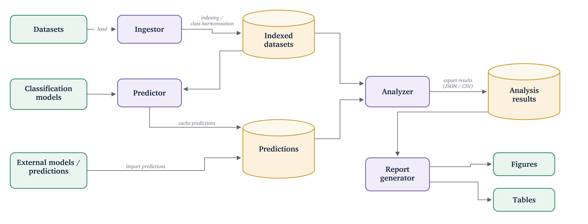

# Cross-Lingual Agreement Between Text and Speech Emotion Recognition

This repository presents a general pipeline for measuring cross-modal consistency in emotion recognition. It evaluates how much emotion recognition models agree across text, speech, and facial expressions, as well as across different languages. The experiments use ten models and four corpora covering eight languages. The results are used to compare decision strategies, including late fusion and withholding the decision when the modalities provide conflicting information.

The experiments are implemented as a common pipeline that supports different datasets and models. It harmonizes emotion labels to six basic emotions defined by Paul Ekman and a neutral class, while allowing other classes to be mapped or excluded. The main stages are:

1. **Ingest** — datasets are loaded and their emotion labels are mapped to a common set of categories. A harmonization report records the applied mappings and excluded labels.
2. **Predict** — configured models are applied to the datasets and their predictions are stored for further analysis. Predictions are cached to avoid repeated model runs when the configuration has not changed.
3. **Analyze** — cross-modal consistency is measured using Cohen's and Fleiss' κ, together with statistical tests, confidence and conflict analysis, and different decision strategies.
4. **Report** — the results are automatically presented as tables, figures, and reports using the same settings for each analysis.

Adding a new dataset requires only mapping its emotion labels to the common categories. Adding a new model requires adding its configuration and output label mapping. The remaining stages are shared across all configurations, which keeps the analysis consistent between models, datasets, and languages.

## Architecture



The four processors are the four CLI stages; the cylinders are the directories under `results/`.

## Modules

The modules are listed in the order of the stages above.

| Stage   | Module                     | Purpose                                                                                                                                            |
| ------- | -------------------------- | -------------------------------------------------------------------------------------------------------------------------------------------------- |
| shared  | `app/config/`            | Paths, random seed, the common emotion set, and the study design: which models were run on which corpus, and which emotions each model can return. |
| shared  | `app/labels/`            | Label mapping. Translates both dataset labels and model outputs into the common set, and marks a prediction as abstained when it falls outside it. |
| Ingest  | `app/data/`              | Dataset loaders, audio and video reading, and the index with its harmonization report.                                                             |
| Predict | `app/models/`            | One shared interface for all ten models, and a registry that builds any of them by name.                                                           |
| Predict | `app/predict/`           | The prediction cache and the batch runner. Cached predictions are reused until a model's configuration changes.                                    |
| Analyze | `app/analysis/`          | Accuracy and F1, Cohen's and Fleiss' κ, confidence intervals, significance tests, conflict analysis, and the decision strategies.                 |
| Report  | `app/report/`            | The shared figure style, colour palette and number formats, and the writers that produce tables and figures.                                       |
| all     | `app/cli.py`             | The five commands: `ingest`, `predict`, `analyze`, `report`, `import-predictions`.                                                       |
| —      | `scripts/`               | Figures and tables for the article, dataset and model overviews, MELD audio extraction, and the Qwen2-Audio runner for a separate GPU machine.     |
| —      | `tests/`                 | Tests. Those that need the datasets or download a model are marked `slow`.                                                                       |
| —      | `weights/`, `results/` | Where the author's own model weights are placed, and the output directory. Neither is versioned.                                                   |

A new dataset needs only a loader and a mapping of its labels. A new model needs its configuration and a mapping of its output labels. A model that cannot be run here only has to save its predictions to a parquet file, which `import-predictions` reads; `scripts/qwen_windows/` is a complete example. Everything else is shared.

## Models

### Public models

Downloaded from Hugging Face on first use into `models/hf_cache` (not versioned).

| Modality | Language | Model                                                                                                                        | Role          |
| -------- | -------- | ---------------------------------------------------------------------------------------------------------------------------- | ------------- |
| Text     | EN       | [j-hartmann/emotion-english-distilroberta-base](https://huggingface.co/j-hartmann/emotion-english-distilroberta-base)         | headline      |
| Text     | multi    | [tabularisai/multilingual-emotion-classification](https://huggingface.co/tabularisai/multilingual-emotion-classification)     | headline (PL) |
| Text     | multi    | [poltextlab/xlm-roberta-large-pooled-emotions10-v3](https://huggingface.co/poltextlab/xlm-roberta-large-pooled-emotions10-v3) | secondary     |
| Text     | PL       | [visegradmedia-emotion/Emotion_RoBERTa_polish6](https://huggingface.co/visegradmedia-emotion/Emotion_RoBERTa_polish6)         | secondary     |
| Speech   | multi    | [Qwen/Qwen2-Audio-7B-Instruct](https://huggingface.co/Qwen/Qwen2-Audio-7B-Instruct), zero-shot                                | headline      |
| Speech   | EN       | [speechbrain/emotion-recognition-wav2vec2-IEMOCAP](https://huggingface.co/speechbrain/emotion-recognition-wav2vec2-IEMOCAP)   | secondary     |
| Face     | —       | [trpakov/vit-face-expression](https://huggingface.co/trpakov/vit-face-expression)                                             | —            |

Each model is either **headline** (clean: never trained on the corpus it is evaluated on, so it carries the reported results) or **secondary** (a comparison point only).

### Own models

These models are not included in the repository. They are available upon contact with the author.

| Modality | Language | Model                                                                                           | Place the files in                                        |
| -------- | -------- | ----------------------------------------------------------------------------------------------- | --------------------------------------------------------- |
| Speech   | EN / PL  | CNN-Transformer, two checkpoints (RAVDESS 8 classes, nEMO 6 classes) — retrained by the author | `weights/speech_cnn/`                                   |
| Text     | PL       | Own LSTM over fastText-style embeddings, run in an isolated interpreter                         | `weights/text_lstm/nkjp+wiki-forms-all-300-cbow-ns_v2/` |
| Text     | PL       | Own Polish RoBERTa-v2 fine-tuned in a separate project                                         | —                                                        |

The LSTM directory name is part of the model's cache signature, so it has to be kept exactly as above. Everything except these three models runs without them.

The CNN-Transformer and the LSTM are trained on the corpora they are evaluated on, so they are declared **leaky** and never carry a headline result. The Polish RoBERTa-v2 is not leaky, but it is still reported as a secondary model.

## Data

Datasets are not redistributed. Download them and place the files exactly at these paths, relative to the repository root (or point `TSER_DATASETS_ROOT` elsewhere; `TSER_RESULTS_ROOT` moves the outputs). A wrong layout raises an error rather than silently skipping data.

| Dataset           | Role                                                                  | Source                                                                        | Path                                                                                                               |
| ----------------- | --------------------------------------------------------------------- | ----------------------------------------------------------------------------- | ------------------------------------------------------------------------------------------------------------------ |
| **nEMO**    | Polish acted speech                                                   | [amu-cai/nEMO](https://huggingface.co/datasets/amu-cai/nEMO) (Git-LFS clone)   | `datasets/nEMO/data/*.parquet`                                                                                   |
| **CAMEO**   | eight languages (en, pl, de, fr, it, es, ru, bn)                      | [amu-cai/CAMEO](https://huggingface.co/datasets/amu-cai/CAMEO) (Git-LFS clone) | `datasets/CAMEO/data/<corpus>-00000-of-00001.parquet`                                                            |
| **RAVDESS** | English acted speech **and video** — the only tri-modal corpus | [Zenodo 1188976](https://zenodo.org/records/1188976) (audio + video archives)  | audio `datasets/RAVDESS/Audio_Speech_Actors_01-24/Actor_<NN>/*.wav`, video `datasets/RAVDESS/Actor_<NN>/*.mp4` |
| **MELD**    | English natural dialogue                                              | [MELD](https://affective-meld.github.io/) (`MELD.Raw`)                       | `datasets/MELD/MELD.Raw/` + `datasets/MELD/audio/`                                                             |

`results/` is created by the pipeline and holds the index (`results/index/`), the prediction cache (`results/predictions/`), the analysis bundles (`results/analysis/`) and the rendered figures and tables. None of it is versioned; because the prediction cache keeps the complete score vector, new analyses are computed from the cache without re-running inference.

## Usage

Python 3.12. Run everything from the repository root — paths in the tests and in `scripts/` are relative.

```bash
python3.12 -m venv .venv && source .venv/bin/activate
pip install -r requirements.txt
```

```bash
python -m app.cli ingest  --corpus nemo|ravdess|cameo|meld   # index + harmonization report
python -m app.cli predict --study 1 --corpus nEMO --model all  # cached; a re-run is a no-op
python -m app.cli analyze --study 1                            # bundle.json + agreements.md
python -m app.cli report  --study 1                            # figures/ + tables/

python -m app.cli import-predictions --file qwen.parquet --study 1 --corpus MELD
PYTHONPATH=. python scripts/article_tables.py                  # publication tables
pytest -m "not slow"                                           # 2 skip without RAVDESS
```

The Polish LSTM is the only model needing extra setup: it runs in its own interpreter so that TensorFlow stays out of the main environment, so create `.venv-tf` from `requirements-tf.txt`. As pinned, that environment is macOS only; every other model works without it. Inference runs on CPU, using Apple Silicon when available.

## Citation

The code is released under the [MIT License](LICENSE). If you use it, please cite the paper below. The datasets and models remain subject to their own licenses and terms of use.

```bibtex
@inproceedings{TODO
}
```
