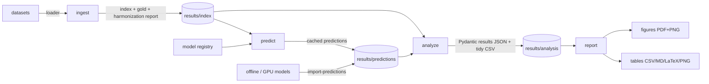

# Cross-Modal Emotion-Agreement Pipeline — tool documentation

A reproducible, **corpus- and model-agnostic** framework for measuring **agreement between
modalities** (text / speech / face) in emotion recognition — across datasets and languages.
Its value is not a new classifier but the **methodology encoded as reusable stages**: canonical
label harmonization, a common-support rule, leakage-aware model roles, agreement statistics with
bootstrap CIs, and deterministic reporting. Plugging in a new corpus or model is a small, local
change; the analysis and figures come for free.

## Why this is a contribution

Cross-modal emotion studies are usually one-off scripts tied to one dataset and a fixed label set.
This tool factors out the reusable parts:

- **Harmonization to a canonical space** (Ekman-6 + neutral) with *fail-loud* label mapping and
  explicit reporting of every dropped (non-Ekman) label — so heterogeneous corpora become comparable.
- **Common-support rule** — κ between two models is computed only on classes both can emit, dropping
  gold outside that intersection and abstentions, and always reporting `n_used / n_excluded`.
- **Model roles** — clean (headline) vs leaky/secondary are declared once and honored everywhere, so
  "which modality is closer to gold" conclusions never rest on data-leaking models.
- **Prediction cache** — predictions are the only expensive artifact; computed once, versioned by a
  config signature, reused by analysis and reporting.
- **Statistics** — Cohen's & Fleiss' κ, 1000× percentile bootstrap CIs, McNemar (paired within a set),
  two-proportion / χ² (unpaired across sets), conflict analysis, confidence correlation.
- **Deterministic reporting** — fixed seed, fixed palette + class order; tables in CSV/Markdown/LaTeX/PNG
  and figures in PDF+PNG regenerate identically from the cached analysis.

## Architecture (staged pipeline)



Five CLI stages: **`ingest → predict → analyze → report`** (+ `import-predictions` for models run
off-box, e.g. a GPU-only audio-LLM).

## Components (by responsibility)

| area | modules | responsibility |
|---|---|---|
| **config** | `config/emotions.py`, `settings.py`, `studies.py` | canonical emotion enum + palette/order; paths/seed; the study design — which models ran on which (study, corpus), headline vs secondary/leaky flags, and each model's supported classes |
| **labels** | `labels/mapping.py`, `mapper.py` | raw→canonical mapping (fail-loud), DROP set for non-Ekman; per-model native→canonical score aggregation |
| **data** | `data/schema.py`, `ingest.py`, `index_io.py`, `audio.py`, `video.py`, `loaders/*` | `Sample`/`AudioRef` contract; gold resolution + harmonization report; corpus loaders (nEMO, CAMEO, RAVDESS, MELD); audio decode; face-frame extraction |
| **models** | `models/registry.py`, `base.py`, `text/*`, `speech/*`, `face/*` | `EmotionModel` protocol (`predict_batch`, `config_signature`); a registry that builds any model by id; HF text, custom CNN-Transformer speech, speechbrain, Qwen zero-shot prompt/parser, ViT face, subprocess-isolated Keras LSTM |
| **predict** | `predict/store.py`, `runner.py` | versioned parquet prediction cache (config-signature invalidation, resume); batch runner |
| **analysis** | `analysis/agreement.py`, `bootstrap.py`, `metrics.py`, `tests.py`, `conflicts.py`, `correlation.py`, `lang_features.py`, `results.py`, `run.py` | common-support alignment + Cohen/Fleiss κ; bootstrap CIs; baselines; McNemar/two-proportion; conflict + confidence; typological features; Pydantic result schemas; orchestration |
| **report** | `report/style.py`, `tables.py`, `figures.py`, `run.py` | shared style; table writers (4 formats); confusion / κ-CI / conflict / scatter figures |

## Install

```bash
python3.12 -m venv .venv && source .venv/bin/activate
pip install -r requirements.txt
# optional second env for the isolated Keras LSTM:  .venv-tf (Python 3.11, TF 2.15)
```

## Usage — end to end

```bash
# 1. build the corpus index (resolves gold, writes a harmonization report)
python -m app.cli ingest --corpus nemo|ravdess|cameo|meld

# 2. run a model over a corpus (cached; re-run is a no-op unless config changes)
python -m app.cli predict --study 1 --corpus nEMO --model mling_tabularis
python -m app.cli predict --study 1 --corpus RAVDESS --model all      # every model in the roster

# 2b. import predictions computed off-box (e.g. Qwen on a GPU machine)
python -m app.cli import-predictions --file qwen.parquet --study 1 --corpus MELD

# 3. compute statistics -> results/analysis/study{N}/bundle.json (+ tidy CSV)
python -m app.cli analyze --study 1

# 4. render figures + tables -> results/figures|tables/study{N}/
python -m app.cli report --study 1
```

Every stage is idempotent and tolerant of missing pieces: `analyze` skips models/corpora that
have no predictions yet (with a warning), so you can run partially and re-run as data arrives.

## Extending the tool

**Add a corpus** — write `data/loaders/<name>.py` returning `list[Sample]` (id, studies, corpus,
language, text, `AudioRef`, gold_raw, optional video). Wire it into the `ingest` CLI and add its
entry to `studies.ROSTER`. Nothing else changes.

**Add a model** — implement the `EmotionModel` protocol (`predict_batch`, `config_signature`,
`model_id`, `modality`) and register it in `models/registry.py`; declare its modality and supported
classes in `studies.py`. It is now available to `predict` and to all analysis/reporting.

**A model that can't run here** (GPU-only, offline) — run it anywhere with a standalone script that
emits `[sample_id, corpus, raw_response, pred]` (sample_id must match the loader), then
`import-predictions`. See `scripts/qwen_windows/` for a complete example (Qwen2-Audio on a Windows
GPU box).

**Add a modality** — the modality is just a string on the model + `Sample`; agreement/κ works for
any pair, and confusion/report handle it generically.

## Outputs

- `results/index/study{N}/<corpus>.parquet` + `.report.json` (gold + harmonization counts)
- `results/predictions/study{N}/<corpus>/<model>.parquet` (cached, versioned)
- `results/analysis/study{N}/bundle.json` + `agreements.csv` (all statistics, Pydantic-typed)
- `results/figures/study{N}/*.{pdf,png}` and `results/tables/study{N}/*.{csv,md,tex,png}`

## Limitations / scope

- Research-grade, not a packaged library (no `pip install`; run in-repo via the CLI).
- Bootstrap is pure-Python — fine for ≤~15k samples per pair; large corpora take minutes.
- Face extraction is a single-face Haar heuristic (fine for one-speaker video; multi-speaker scenes
  need active-speaker detection, out of scope).
- Confidence is model-dependent and skipped for zero-shot models (unreliable).
- Correctness-critical maths (κ, exclusions, bootstrap, tests) are unit-tested; report rendering is
  smoke-tested.
```
