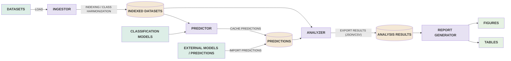

# Cross-Modal Emotion-Agreement Pipeline — tool documentation

A reproducible, **corpus- and model-agnostic** framework for measuring **agreement between
modalities** (text / speech / face) in emotion recognition — across datasets and languages.
Its value is not a new classifier but the **methodology encoded as reusable stages**: canonical
label harmonization, a common-support rule, leakage-aware model roles, agreement statistics with
bootstrap CIs, and deterministic reporting. Plugging in a new corpus or model is a small, local
change; the analysis and figures come for free.

## Why this is a contribution

Cross-modal emotion studies are usually one-off scripts tied to one dataset and a fixed label set.
This tool factors out the reusable parts:

- **Harmonization to a canonical space** (Ekman-6 + neutral) with *fail-loud* label mapping and
  explicit reporting of every dropped (non-Ekman) label — so heterogeneous corpora become comparable.
- **Common-support rule** — κ between two models is computed only on classes both can emit, dropping
  gold outside that intersection and abstentions, and always reporting `n_used / n_excluded`.
- **Model roles** — clean (headline) vs leaky/secondary are declared once and honored everywhere, so
  "which modality is closer to gold" conclusions never rest on data-leaking models.
- **Prediction cache** — predictions are the only expensive artifact; computed once, versioned by a
  config signature, reused by analysis and reporting.
- **Statistics** — Cohen's & Fleiss' κ, 1000× percentile bootstrap CIs, McNemar (paired within a set),
  two-proportion / χ² (unpaired across sets), conflict analysis, confidence correlation.
- **Deterministic reporting** — fixed seed, fixed palette + class order; tables in CSV/Markdown/LaTeX/PNG
  and figures in PDF+PNG regenerate identically from the cached analysis.

## Architecture (staged pipeline)



Five CLI stages: **`ingest → predict → analyze → report`** (+ `import-predictions` for models run
off-box, e.g. a GPU-only audio-LLM).

## The four stages, in detail

### 1. `ingest` — raw datasets → gold-resolved corpus index

Reads one corpus, resolves every utterance's gold label into the canonical space, and writes an
index plus a harmonization report. Components:

- **Loaders** `data/loaders/{nemo,cameo,meld}.py`, `data/ravdess.py` — turn a raw corpus into a
  `list[Sample]` (id, studies, corpus, language, text, `AudioRef`, optional `video_path`, `gold_raw`).
- **Data contract** `data/schema.py` — `Sample` / `AudioRef` Pydantic models (exactly-one audio source).
- **Label harmonization** `labels/mapping.py` — `map_label` (raw → canonical `Emotion` or `None`=DROP;
  *fail-loud* on unknown), plus `MASTER_MAP` and the `DROP_LABELS` set (non-Ekman categories).
- **Gold resolution + report** `data/ingest.py` — `resolve_gold` applies the mapping; `ingest_corpus`
  emits an `IngestReport` (kept / dropped counts, raw→canonical map, per-dropped-label counts).
- **Index I/O** `data/index_io.py` — `write_index` / `read_index` (`Sample` ↔ parquet round-trip).

Input: `datasets/…` → Output: `results/index/study{N}/{corpus}.parquet` + `{corpus}.report.json`.
CLI: `ingest --corpus nemo|ravdess|cameo|meld`.

### 2. `predict` — models over the index (cached, versioned)

Runs each model over a corpus and caches its predictions. Components:

- **Model contract** `models/base.py` — the `EmotionModel` protocol (`model_id`, `modality`,
  `predict_batch`, `config_signature`), the `Prediction` schema, and `to_prediction`.
- **Registry** `models/registry.py` — `build_model(id)` constructs any of the 10 models by id; holds
  per-model native label sets and label overrides.
- **Model implementations** — text: `models/text/hf_text.py`, `text/lstm/*` (subprocess-isolated Keras);
  speech: `models/speech/{features,architectures,cnn_transformer,speechbrain_iemocap}.py` +
  `speech/zeroshot/prompt.py` (Qwen prompt + parser); face: `models/face/vit_face.py`.
- **Label mapper** `labels/mapper.py` — `LabelMapper` maps a model's native scores → canonical space,
  aggregates/renormalizes, and abstains when all probability mass falls on dropped classes.
- **Prediction cache** `predict/store.py` — `PredictionStore`: versioned parquet store with
  `config_signature` invalidation, resume, and a manifest.
- **Runner** `predict/runner.py` — `run_prediction` (batching, resume only on matching config).
- **Off-box import** `data/import_preds.py` — `import_predictions` ingests predictions computed
  elsewhere (e.g. Qwen on a GPU box) from a `[sample_id, corpus, raw_response, pred]` parquet.

Input: index + registry → Output: `results/predictions/study{N}/{corpus}/{model}.parquet`.
CLI: `predict --study N --corpus X --model all|<id>`, `import-predictions`.

### 3. `analyze` — predictions + gold → typed statistics

Computes every statistic into one Pydantic bundle. Components:

- **Orchestration** `analysis/run.py` — `analyze_study` loads gold + predictions, skips whatever is
  missing (with a warning), and drives all of the below.
- **Baselines** `analysis/metrics.py` — accuracy, macro-F1, confusion matrix per model.
- **Agreement** `analysis/agreement.py` — common-support `aligned_pairs` (the §-exclusions), Cohen's κ
  (`cohen_kappa`), Fleiss' κ (`fleiss_kappa`).
- **Bootstrap CIs** `analysis/bootstrap.py` — 1000× percentile CI per κ + PL-vs-EN difference CI (seed 20260723).
- **Significance tests** `analysis/tests.py` — McNemar (paired, within one corpus), two-proportion (unpaired).
- **Conflicts** `analysis/conflicts.py` — which modality is closer to gold on disagreement, per-emotion.
- **Confidence** `analysis/correlation.py` — Pearson / Spearman across modalities (skips zero-shot).
- **Language features** `analysis/lang_features.py` — syntactic distance (URIEL/lang2vec) + resource tier.
- **Result schemas** `analysis/results.py` — the `AnalysisBundle` Pydantic model + JSON / tidy-CSV writers.
- **Study design** `config/studies.py` — roster per (study, corpus), headline pairs, `SUPPORTED` classes, `SPLIT_LANG`.

Input: index + predictions → Output: `results/analysis/study{N}/bundle.json` + `agreements.csv`.
CLI: `analyze --study N`.

### 4. `report` — analysis bundle → deterministic figures + tables

Regenerates all article artefacts from the bundle, identically every time. Components:

- **Orchestration** `report/run.py` — `report_study` reads the bundle and writes every artefact.
- **Style** `report/style.py` — colorblind palette + fixed class order, `apply()` rcParams,
  `save_fig` (PDF+PNG), table→PNG helper.
- **Tables** `report/tables.py` — `write_table` (CSV / Markdown / LaTeX / PNG) + builders (kappa,
  baselines, study2, PL-vs-EN).
- **Figures** `report/figures.py` — confusion matrices, κ-with-CI, conflict bars, Study-2 scatter.

Input: analysis bundle → Output: `results/figures/study{N}/*.{pdf,png}` + `results/tables/study{N}/*.{csv,md,tex,png}`.
CLI: `report --study N`.

## Shared foundation (used by every stage)

- **`config/emotions.py`** — the canonical `Emotion` enum, `CANONICAL_ORDER`, and the fixed
  colorblind-safe per-emotion palette (`EMOTION_COLORS`).
- **`config/settings.py`** — dataset/results paths, the RNG seed, and run configuration (Pydantic settings).
- **`labels/`** — the single canonical-space mapping, applied both to gold (at `ingest`) and to model
  outputs (at `predict`), so labels are comparable everywhere.

## Components (quick reference)

| area               | modules                                                                                                                                                           | responsibility                                                                                                                                                                                                                           |
| ------------------ | ----------------------------------------------------------------------------------------------------------------------------------------------------------------- | ---------------------------------------------------------------------------------------------------------------------------------------------------------------------------------------------------------------------------------------- |
| **config**   | `config/emotions.py`, `settings.py`, `studies.py`                                                                                                           | canonical emotion enum + palette/order; paths/seed; the study design — which models ran on which (study, corpus), headline vs secondary/leaky flags, and each model's supported classes                                                 |
| **labels**   | `labels/mapping.py`, `mapper.py`                                                                                                                              | raw→canonical mapping (fail-loud), DROP set for non-Ekman; per-model native→canonical score aggregation                                                                                                                                |
| **data**     | `data/schema.py`, `ingest.py`, `index_io.py`, `audio.py`, `video.py`, `loaders/*`                                                                     | `Sample`/`AudioRef` contract; gold resolution + harmonization report; corpus loaders (nEMO, CAMEO, RAVDESS, MELD); audio decode; face-frame extraction                                                                               |
| **models**   | `models/registry.py`, `base.py`, `text/*`, `speech/*`, `face/*`                                                                                         | `EmotionModel` protocol (`predict_batch`, `config_signature`); a registry that builds any model by id; HF text, custom CNN-Transformer speech, speechbrain, Qwen zero-shot prompt/parser, ViT face, subprocess-isolated Keras LSTM |
| **predict**  | `predict/store.py`, `runner.py`                                                                                                                               | versioned parquet prediction cache (config-signature invalidation, resume); batch runner                                                                                                                                                 |
| **analysis** | `analysis/agreement.py`, `bootstrap.py`, `metrics.py`, `tests.py`, `conflicts.py`, `correlation.py`, `lang_features.py`, `results.py`, `run.py` | common-support alignment + Cohen/Fleiss κ; bootstrap CIs; baselines; McNemar/two-proportion; conflict + confidence; typological features; Pydantic result schemas; orchestration                                                        |
| **report**   | `report/style.py`, `tables.py`, `figures.py`, `run.py`                                                                                                    | shared style; table writers (4 formats); confusion / κ-CI / conflict / scatter figures                                                                                                                                                  |

## Install

```bash
python3.12 -m venv .venv && source .venv/bin/activate
pip install -r requirements.txt
# optional second env for the isolated Keras LSTM:  .venv-tf (Python 3.11, TF 2.15)
```

## Usage — end to end

```bash
# 1. build the corpus index (resolves gold, writes a harmonization report)
python -m app.cli ingest --corpus nemo|ravdess|cameo|meld

# 2. run a model over a corpus (cached; re-run is a no-op unless config changes)
python -m app.cli predict --study 1 --corpus nEMO --model mling_tabularis
python -m app.cli predict --study 1 --corpus RAVDESS --model all      # every model in the roster

# 2b. import predictions computed off-box (e.g. Qwen on a GPU machine)
python -m app.cli import-predictions --file qwen.parquet --study 1 --corpus MELD

# 3. compute statistics -> results/analysis/study{N}/bundle.json (+ tidy CSV)
python -m app.cli analyze --study 1

# 4. render figures + tables -> results/figures|tables/study{N}/
python -m app.cli report --study 1
```

Every stage is idempotent and tolerant of missing pieces: `analyze` skips models/corpora that
have no predictions yet (with a warning), so you can run partially and re-run as data arrives.

## Extending the tool

**Add a corpus** — write `data/loaders/<name>.py` returning `list[Sample]` (id, studies, corpus,
language, text, `AudioRef`, gold_raw, optional video). Wire it into the `ingest` CLI and add its
entry to `studies.ROSTER`. Nothing else changes.

**Add a model** — implement the `EmotionModel` protocol (`predict_batch`, `config_signature`,
`model_id`, `modality`) and register it in `models/registry.py`; declare its modality and supported
classes in `studies.py`. It is now available to `predict` and to all analysis/reporting.

**A model that can't run here** (GPU-only, offline) — run it anywhere with a standalone script that
emits `[sample_id, corpus, raw_response, pred]` (sample_id must match the loader), then
`import-predictions`. See `scripts/qwen_windows/` for a complete example (Qwen2-Audio on a Windows
GPU box).

**Add a modality** — the modality is just a string on the model + `Sample`; agreement/κ works for
any pair, and confusion/report handle it generically.

## Outputs

- `results/index/study{N}/<corpus>.parquet` + `.report.json` (gold + harmonization counts)
- `results/predictions/study{N}/<corpus>/<model>.parquet` (cached, versioned)
- `results/analysis/study{N}/bundle.json` + `agreements.csv` (all statistics, Pydantic-typed)
- `results/figures/study{N}/*.{pdf,png}` and `results/tables/study{N}/*.{csv,md,tex,png}`

## Limitations / scope

- Research-grade, not a packaged library (no `pip install`; run in-repo via the CLI).
- Bootstrap is pure-Python — fine for ≤~15k samples per pair; large corpora take minutes.
- Face extraction is a single-face Haar heuristic (fine for one-speaker video; multi-speaker scenes
  need active-speaker detection, out of scope).
- Confidence is model-dependent and skipped for zero-shot models (unreliable).
- Correctness-critical maths (κ, exclusions, bootstrap, tests) are unit-tested; report rendering is
  smoke-tested.

```

```
